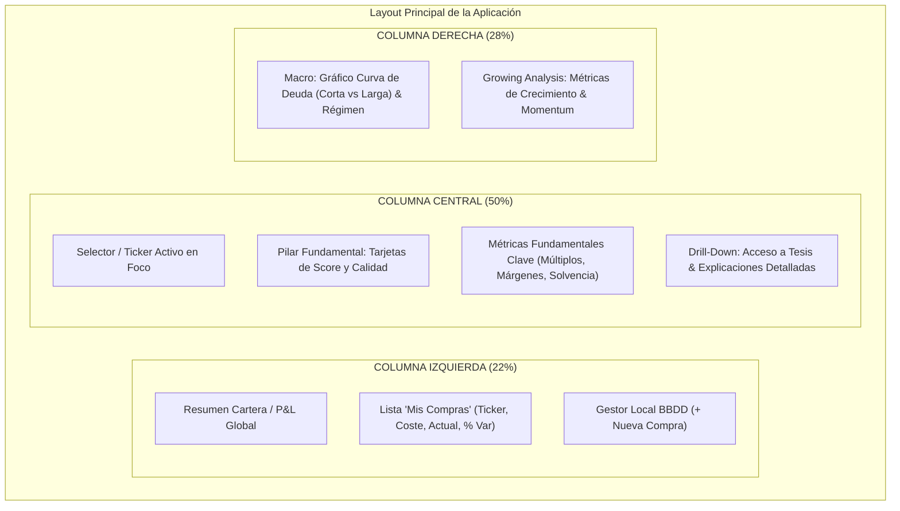
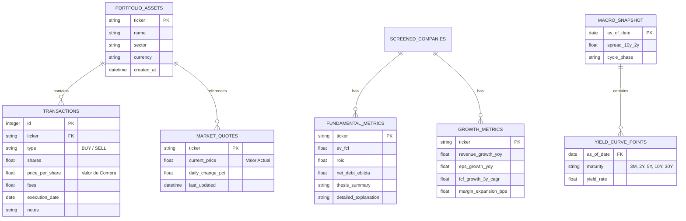

# Especificación de Arquitectura, UI/UX y Modelo de Datos
## Plataforma Gráfica de Apoyo a Decisiones Financieras

---

### 1. Filosofía de Producto y Principios de Diseño

El objetivo principal es ofrecer una herramienta visual institucional para la toma de decisiones de inversión sin fricción ni saturación cognitiva. 

* **Sin redundancia**: Cada pixel y dato en pantalla aporta al análisis contextual. No se duplican valores ni se muestran tablas densas innecesarias en la vista principal.
* **Jerarquía visual limpia**: La pantalla inicial ofrece el resumen ejecutivo esencial ("at-a-glance"). Las explicaciones, desgloses y metodologías profundas están a un solo clic mediante drawers/modales secundarios.
* **Autonomía total**: No depende de APIs de brokers comerciales; el control de la cartera y transacciones se realiza sobre una base de datos local propia.

---

### 2. Design System: Paleta Cromática y Tokens Visuales

El entorno visual sigue la estética de terminales financieras profesionales modernas (dark mode optimizado para reducir fatiga visual y resaltar señales clave de forma inequívoca):

| Rol Visual | Color HEX / Token | Uso Específico |
| :--- | :--- | :--- |
| **Fondo Principal** | `#0B0E14` (Deep Canvas) | Fondo general de la aplicación |
| **Contenedores / Cards** | `#121824` / `#161F30` | Superficies de las 3 columnas y widgets |
| **Bordes y Divisores** | `#1E293B` / `#22314E` | Delimitación sutil entre paneles |
| **Texto Primario** | `#F8FAFC` (Blanco puro) | Tickers, valores monetarios principales, títulos |
| **Texto Secundario** | `#94A3B8` (Gris frío) | Etiquetas, descripciones secundarias, unidades |
| **Acentos / Brand** | `#38BDF8` (Sky Blue) | Botones activos, tabs, líneas de gráficos principales |
| **Acento Resalte Máximo** | `#FACC15` (Vibrant Yellow / Gold) | **Focos de atención máxima**, oportunidades destacadas, alertas del ciclo macro |
| **Indicador Positivo** | `#10B981` (Emerald Green) | Rentabilidad > 0%, spreads positivos, métricas alcistas |
| **Indicador Negativo** | `#EF4444` (Rose Red) | Rentabilidad < 0%, deterioro en métricas |
| **Indicador Neutro** | `#FFFFFF` (Blanco) | Variación = 0.00%, datos referenciales sin sesgo |

---

### 3. Arquitectura del Dashboard (Distribución en 3 Columnas)

---

#### 3.1. Columna Izquierda: Mis Compras (Gestión de Cartera Local)
* **Objetivo**: Monitorizar la cartera personal de activos comprados con lectura instantánea del rendimiento individual y acumulado.
* **Componentes**:
  1. **Header de Portafolio**:
     * Valor Total Invertido vs. Valor Liquidativo Actual.
     * Retorno Total acumulado en divisa y porcentaje.
     * Botón `[ + Añadir Transacción ]` que abre modal de inserción en BBDD.
  2. **Tabla / Tarjetas de Posiciones**:
     * **Activo**: Ticker grande en blanco (`#F8FAFC`) con nombre de la compañía debajo en azul claro (`#38BDF8`).
     * **Valor de Compra**: Precio medio de adquisición ($ o €).
     * **Valor Actual**: Cotización de mercado al momento de refresco.
     * **% Variación Dinámico**:
       * **Verde (`#10B981`)** si `Valor Actual > Valor Compra` (ej. `+14.2%`).
       * **Rojo (`#EF4444`)** si `Valor Actual < Valor Compra` (ej. `-5.8%`).
       * **Blanco (`#FFFFFF`)** si `Valor Actual == Valor Compra` (ej. `0.0%`).
  3. **Interacción**: Al hacer clic en un activo de la lista, la columna central y el bloque growing se sincronizan para examinar dicho activo o contrastarlo contra las oportunidades.

---

#### 3.2. Columna Central: Pilar 1 - Desajuste de Valor Intrínseco (Gordon-Shapiro & MoS 30%)
* **Objetivo**: Evaluar diariamente el universo del S&P 500 en busca de desajustes estructurales entre el precio de cotización ($P_0$) y el valor intrínseco real descontado ($VP$), exigiendo un colchón de protección del 30% basado en la doctrina de **Howard Marks** y **Warren Buffett**.
* **Principios Absolutos de Operación**:
  1. **Política Estricta de Cero Invención (Anti-Hallucination Policy)**: Se trabaja exclusivamente con datos auditados y confirmados. Si falta algún dato ($P_0, D_1 \text{ o } FCFA_1, \beta, g_{\text{hist}}$) o no se cumple $r > g$, la empresa es descartada de forma automática sin imputaciones ni estimaciones complementarias.
  2. **Aceptación de Resultado Vacío**: Si ninguna compañía del S&P 500 supera el filtro, se emite un informe explícito: *"BARRIDO COMPLETADO: Ninguna compañía del S&P 500 cumple el criterio de Margen de Seguridad del 30% de forma simultánea en los escenarios Neutro y Optimista."* (Un resultado vacío es válido y esperado en regímenes de sobrevaloración).
  3. **Margen de Seguridad Defensivo (MoS 30%)**: $VP_{\text{MoS}} = VP_{\text{Teórico}} \times 0.70$.
* **Formulación del Motor de Valoración**:
  * Tasa de descuento exigida $r$ (CAPM): $r = R_f + \beta \cdot (R_m - R_f)$.
  * **3 Escenarios de Crecimiento ($g$) con Pivote Dinámico ($g_{\text{pivote}}$)**:
    1. *Optimista* ($g_{\text{opt}} > g_{\text{pivote}}$): $g_{\text{opt}} = \max(g_{\text{hist}}, g_{\text{pivote}} + 0.01)$, con límite $g_{\text{opt}} < r - 0.01$.
    2. *Neutro* ($g_{\text{neu}} = g_{\text{pivote}}$ base, configurable interactivamente): Si $r \le g_{\text{pivote}}$, se ajusta a $g_{\text{neu}} = r - 0.02$.
    3. *Pesimista* ($g_{\text{pess}} < g_{\text{pivote}}$): $g_{\text{pess}} = \min(g_{\text{hist}}, \max(0.01, g_{\text{pivote}} - 0.03))$.
  * **Filtro de Entrada Conjunto**:
    $$(P_0 \le VP_{\text{MoS, Neutro}}) \quad \text{AND} \quad (P_0 \le VP_{\text{MoS, Optimista}})$$
  * **Métrica de Discrepancia y Ordenación**:
    $$\Delta_{\text{neu}} = \frac{VP_{\text{MoS, Neutro}} - P_0}{P_0} \times 100\%$$
    Las empresas se ordenan de **MAYOR a MENOR $\Delta_{\text{neu}}$** (mayor descuento a favor del inversor primero).
* **Componentes de la UI**:
  1. **Barra de Auditoría**: Fecha, universo analizado, contador de descarte por cero invención y compañías calificadas.
  2. **Control Interactivo de Pivote ($g$)**: Barra deslizante (slider) de 3.0% a 15.0% con indicador en amarillo y botones de acceso rápido (5.0% Conservador, 7.0% Estándar, 9.0% Crecimiento, 11.0% Agresivo) para recalcular las valoraciones en tiempo real.
  3. **Selector de Compañías**: Pestañas ordenadas por mayor discrepancia $\Delta_{\text{neu}}$.
  4. **Hero Card de la Compañía en Foco**: Ticker, Nombre, Sector, $P_0$, $r$ y caja destacada en amarillo (`#FACC15`) con $\Delta_{\text{neu}}$.
  5. **Tarjetas de los 3 Escenarios**: Comparador visual dinámico con $g$, $VP_{\text{teórico}}$, $VP_{\text{MoS, 30\%}}$ y badges de validación según el pivote seleccionado.
  6. **Barra de Posicionamiento de Precio**: Indicador visual relativo entre $P_0$, $VP_{\text{MoS}}$ y $VP_{\text{teórico}}$.
  7. **Modal de Auditoría Metodológica (`ThesisModal`)**: Desglose paso a paso de fórmulas, parámetros CAPM y doctrina de preservación del capital.

---

#### 3.3. Columna Derecha: Macro & Análisis Growing
* **Esquina Superior Derecha: Macro & Curva de Deuda**:
  * **Gráfico de Rendimiento de Curva Soberana**:
    * Eje X: Vencimientos (3 Meses, 2 Años, 5 Años, 10 Años, 30 Años).
    * Eje Y: Rentabilidad (%) de los bonos del tesoro.
    * Visualización simultánea: **Curva Actual** (línea sólida azul claro `#38BDF8`) vs. **Curva de hace 6 meses/1 año** (línea discontinua tenue `#64748B`).
  * **Indicador de Régimen / Ciclo Económico**:
    * Diferencial de tipos (Spread 10Y - 2Y) con badge de estado: *Normalizada*, *Invertida*, *Desinversión / Steepening*.
    * Marcador visual de ciclo (Expansión, Desaceleración, Recesión, Recuperación) resaltado con sutil amarillo de atención.
* **Bloque Inferior Derecho: Análisis Growing**:
  * **Objetivo**: Evaluar la aceleración y tracción operativa de las empresas filtradas.
  * **Métricas Visuales de Crecimiento**:
    * **Crecimiento de Ingresos (Revenue Growth)**: Variación YoY y CAGR 3 años.
    * **Crecimiento de Beneficio por Acción (EPS / BPA)**: Crecimiento reportado y aceleración trimestral.
    * **Expansión de Márgenes**: Tendencia de margen bruto y libre de caja.
    * **Rule of 40 / Efficiency Score**: Gráfico de barras horizontales limpio que compara crecimiento vs. rentabilidad.

---

### 4. Modelo de Datos y Esquema de BBDD Local

Dado que la aplicación **no se conecta a brokers**, el sistema de gestión de compras se basa en una base de datos embebida local (SQLite).

---

### 5. Arquitectura Técnica Recomendada

Para conseguir una UI premium, con dark mode perfecto, gráficos de latencia cero y base de datos local embebida:

1. **Frontend / Presentación**:
   * **Framework**: React + Vite (o entorno de escritorio ligero como Electron / Tauri o Next.js local).
   * **Estilos**: Tailwind CSS con paleta dark mode configurada.
   * **Librería de Gráficos**: Recharts o Lightweight Charts (gráficos vectoriales interactivos de alto rendimiento).
   * **Iconografía**: Lucide Icons.
2. **Capa de Persistencia (BBDD Local)**:
   * **Motor**: SQLite (archivo local `portfolio.db`). Sin necesidad de servidores externos.
   * **Lectura/Escritura**: CRUD completo de compras (Insertar compra, calcular precio medio ponderado, historizar).
3. **Capa de Ingesta de Datos (Data Ingestion Adapters)**:
   * **Módulo de Cotizaciones**: Adaptador modular para leer precios actuales (vía API pública de mercado, Yahoo Finance API o importador de CSV).
   * **Módulo Macro**: Lectura de datos de curvas del tesoro (ej. FRED - Federal Reserve Economic Data o benchmarks de bonos).
   * **Módulo Fundamental / Growing**: Contrato JSON estructurado donde se consumirán los datos de las empresas candidatas para alimentar los dos paneles de la derecha y centro.
